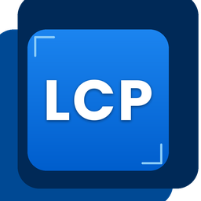

# PCL LCP 修改版（PCL LCP Edition）

> **重要声明**
>
> 本软件是**第三方基于 Plain Craft Launcher（PCL）独立进行的二次创作修改版**，**并非 PCL 官方发布**，
> 与 PCL 官方及 PCL 社区版官方均无隶属关系。
>
> 本修改版在原版基础上替换了品牌图标与标题栏标识（LCP Edition），并包含若干本地修复。
> 发布与使用请遵循文末《许可与署名》中的条款。

<p align="center">
  
</p>

## 简介

PCL LCP 修改版是基于 PCL 社区版（PCL2 CE）v2.15.1 / Build 524 的第三方修改版本。界面与功能保持原版结构，
启动器内的 Logo 已替换为 LCP 版标识，同时包含登录、联机大厅、下载与更新源方面的本地修复。

## 本版改动

- **品牌标识**：窗口/文件图标、标题栏字标、关于页头像、启动画面 Logo 替换为 LCP；窗口标题显示为 `LCP`
- **正版登录**：补上微软 OAuth 客户端 ID 回退，不再报 `Microsoft OAuth client id is not configured`
- **联机大厅**：补上 `LINK_SERVER_ROOT` 回退，不再报无法连接到大厅服务器
- **大厅 Natayark 登录**：授权与换 token 使用内置 `pclce2025` 客户端，不再 401 / `invalid_request`
- **解除地区限制**：原版下载、版本补全/修复、整合包安装、加载器安装不再弹「地区不可用」
- **离线验证入口默认可用**
- **更新源**：Naids 优先；被墙源连接失败只记 WARN，不再弹红色提示

> 以上改动为本地自用性质，是否分发与使用风险请自行判断。

## 下载与运行

1. 下载 `PCL-LCP-Edition_2.15.1_x64.exe`
2. 需要 **.NET 10 Desktop Runtime（x64）**，可运行 Release 附带的
   `windowsdesktop-runtime-10.0.15-win-x64.exe` 安装
3. 双击启动；账号、档案、皮肤数据保存在 `%APPDATA%\PCLCE`

**文件校验**

```
文件    PCL-LCP-Edition_2.15.1_x64.exe
大小    23,487,781 字节
SHA256  c7fd5b0ee4ada8952b1327a9f715dbbbe0d5fd9e95f2e995c2a99a70e789c72e
```

## 品牌素材

`logo/` 目录提供本版使用的 LCP 图标，可用于仓库头像、Release 头图或文档：

| 文件 | 用途 |
| --- | --- |
| `logo/lcp-1024.png` | 主 Logo（透明背景） |
| `logo/lcp-512.png` | 圆形头像 / 关于页 |
| `logo/lcp-256.png` | 应用图标 PNG |
| `logo/lcp.ico` | Windows 图标（多尺寸） |
| `logo/social-preview.png` | 仓库社交预览图（1280×640） |
| `logo/preview-titlebar.png` | 标题栏效果预览（示意） |

## 源代码

本修改版以开源方式发布，源码与修改说明见本仓库；如仅提供二进制，请以补丁或源码形式补充，
以满足《PCL 存储库合理使用指南》中“公开源代码”的要求。

## 许可与署名

本修改版依据 PCL 的《PCL 分发有限许可》与《PCL 存储库合理使用指南》发布：

1. 本软件为第三方基于 PCL 独立进行的二次创作产物，非官方发布；
2. 名称以 `PCL` 开头，并带有表明第三方修改的后缀（`LCP 修改版`）；
3. 保留 Minecraft 正版购买劝导与赞助劝导；
4. 界面主色保持蓝色，不包含与 PCL 赞助解锁类似的功能。

除 `Plain Craft Launcher 2/` 目录外，PCL 社区版其余组件遵循 **Apache License 2.0**，
完整文本见 `LICENSE`。本修改版对以下文件进行了修改：图标资源（`Images/icon.ico`、`Images/icon.png`、
`Images/Heads/Logo*.png`）、标题栏字标与窗口标题、以及登录/联机/更新源相关的本地逻辑。

## 免责声明

- 自编译二进制**没有数字签名**；版本号保持 2.15.1
- 本软件为社区修改版，与 PCL、PCL 社区版官方无关
- 内置凭据与解除地区限制属于本地自用改动，分发与使用风险请自行判断
